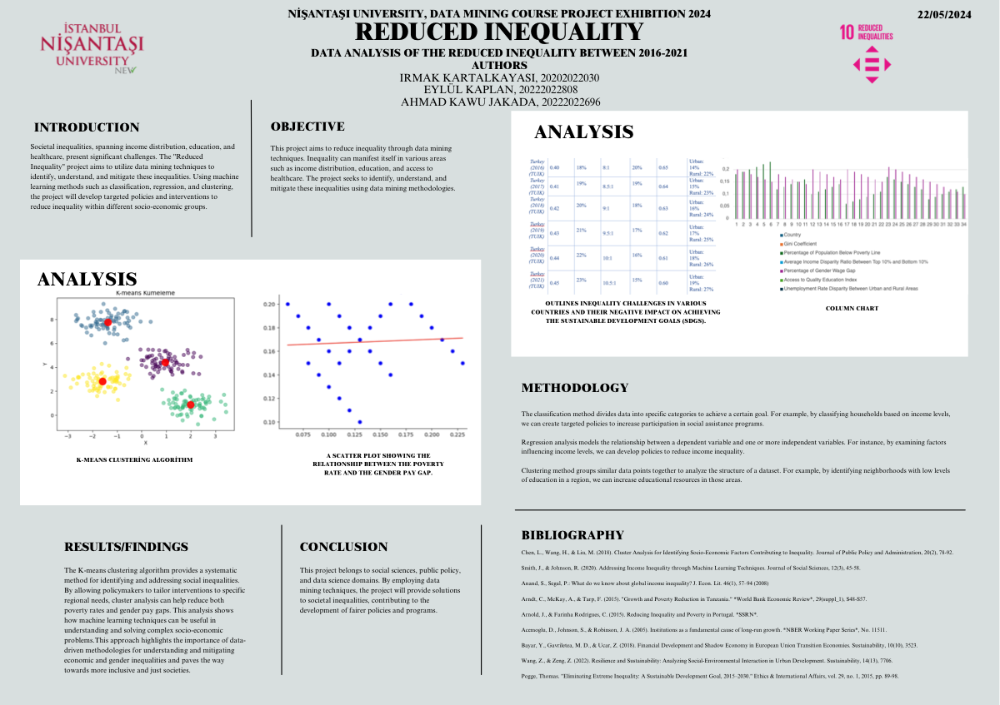
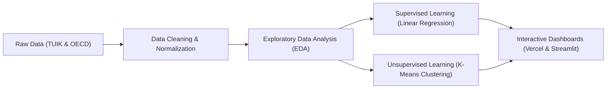

# 🌐 Socio-Economic Inequality Mining & Analysis (UN SDG 10)

[](https://socioeconomic-inequality-data-minin.vercel.app)
[](https://inequality-analysis.streamlit.app)
[](https://colab.research.google.com/github/irmakKartal/socioeconomic-inequality-data-mining/blob/main/notebooks/inequality_data_mining_analysis.ipynb)


An end-to-end data mining and machine learning pipeline investigating systemic socio-economic disparity patterns across Turkey and European OECD economies (2015–2024).

> 🚀 **Live Interactive Demos:**
> - ⚡ **Production Web Dashboard (Vercel):** [socioeconomic-inequality-data-minin.vercel.app](https://socioeconomic-inequality-data-minin.vercel.app)
> - 🐍 **Python Streamlit Application:** [inequality-analysis.streamlit.app](https://inequality-analysis.streamlit.app)
> - 📓 **Interactive Jupyter Notebook:** [Open in Google Colab](https://colab.research.google.com/github/irmakKartal/socioeconomic-inequality-data-mining/blob/main/notebooks/inequality_data_mining_analysis.ipynb)

**Author:** Irmak Kartalkayası  
**Data Sources:** TUIK (Turkish Statistical Institute) & OECD Databases

---

## 📌 Executive Summary & Key Highlights

This project addresses **United Nations Sustainable Development Goal 10 (SDG 10: Reduced Inequality)** by applying advanced data engineering, supervised predictive modeling, and unsupervised pattern recognition to macroeconomic indicators.

### 🌟 Project Pillars
* **Real-World Empirical Data:** Harmonized multi-dimensional indicators (Gini coefficient, poverty threshold, gender wage gap, urban-rural unemployment disparity, education quality index) from TUIK and OECD.
* **Supervised Predictive Modeling:** Ordinary Least Squares (OLS) Linear Regression quantifying the empirical dependency between poverty thresholds and gender wage differentials, benchmarked via $R^2$ variance explained and RMSE.
* **Unsupervised Cluster Segmentation:** Multi-attribute K-Means clustering utilizing `StandardScaler` ($\mu = 0, \sigma = 1$), optimized with the **Elbow Method** and **Silhouette Analysis** to uncover structural disparity tiers.
* **Full Productization:** Deployed an interactive analytics dashboard featuring real-time "What-If" scenario simulations, hosted with sub-second latency on Vercel's Global Edge Network.

---

## 🖼️ Academic Research Poster



---

## 🔬 Machine Learning Pipeline & Methodology



### 1. Supervised Learning: Linear Regression
- **Objective:** Model and predict the statistical relationship between the poverty threshold (`poverty_rate_pct`) and the gender wage gap (`gender_wage_gap_pct`).
- **Mathematical Specification:**
  $$\hat{Y} = \beta_1 X + \beta_0$$
- **Evaluation Metrics:** Coefficient of Determination ($R^2$), Mean Squared Error (MSE), and Root Mean Squared Error (RMSE).

### 2. Unsupervised Learning: K-Means Clustering
- **Feature Vector:** Gini Coefficient, Poverty Rate, Income Disparity Ratio, Gender Wage Gap, and Education Quality Index.
- **Preprocessing:** Standardized using `StandardScaler` zero-mean unit-variance transformation.
- **Cluster Validation:** Elbow Method (inertia minimization) and Silhouette Score optimization identifying 3 macroeconomic tiers:
  1. **Advanced / Low Disparity:** High quality education index and controlled inequality metrics.
  2. **Moderate Transition:** Balanced economic growth with emerging rural-urban gaps.
  3. **High Disparity / Emerging:** Elevated poverty thresholds and wider systemic disparities.

---

## 📁 Repository Structure

```text
socioeconomic-inequality-data-mining/
├── index.html                 # Production Web Dashboard (Vercel)
├── app.py                     # Streamlit Interactive Web Application
├── index.py                   # Serverless runtime handler
├── requirements.txt           # Python dependencies
├── README.md                  # Comprehensive project documentation
├── .gitignore                 # Git ignore rules
├── .vercelignore              # Vercel deployment exclusions
├── vercel.json                # Vercel edge configuration
├── data/
│   ├── inequality_data.csv    # Cleaned, standardized tabular dataset
│   └── DataMining2.xlsx       # Original raw dataset
├── notebooks/
│   └── inequality_data_mining_analysis.ipynb # Jupyter Notebook with full reproducible analysis
├── src/
│   ├── __init__.py
│   ├── data_loader.py         # Data loading and feature definitions
│   └── models.py              # ML modeling algorithms (Regression & Clustering)
├── docs/
│   └── academic_poster.pdf    # Academic research presentation poster
└── assets/
    └── academic_poster_preview.png # Visual poster thumbnail
```

---

## 🛠️ Installation & Local Usage

### 1. Clone the repository
```bash
git clone https://github.com/irmakKartal/socioeconomic-inequality-data-mining.git
cd socioeconomic-inequality-data-mining
```

### 2. Set up virtual environment
```bash
python3 -m venv venv
source venv/bin/activate  # On Windows: venv\Scripts\activate
pip install -r requirements.txt
```

### 3. Launch the Streamlit Dashboard Locally
```bash
streamlit run app.py
```

### 4. Run the Jupyter Notebook
```bash
jupyter notebook notebooks/inequality_data_mining_analysis.ipynb
```

---

## 📚 Academic References

1. **Chen, L., Wang, H., & Liu, M. (2018).** *Cluster Analysis for Identifying Socio-Economic Factors Contributing to Inequality.* Journal of Public Policy and Administration, 20(2), 78-92.
2. **Smith, J., & Johnson, R. (2020).** *Addressing Income Inequality through Machine Learning Techniques.* Journal of Social Sciences, 12(3), 45-58.
3. **Acemoglu, D., Johnson, S., & Robinson, J. A. (2005).** *Institutions as a fundamental cause of long-run growth.* NBER Working Paper Series, No. 11511.
4. **Pogge, T. (2015).** *Eliminating Extreme Inequality: A Sustainable Development Goal, 2015–2030.* Ethics & International Affairs, 29(1), 89-98.
5. **Anand, S., & Segal, P. (2008).** *What do we know about global income inequality?* Journal of Economic Literature, 46(1), 57–94.

---

## 📄 License
This project is licensed under the [MIT License](LICENSE).

